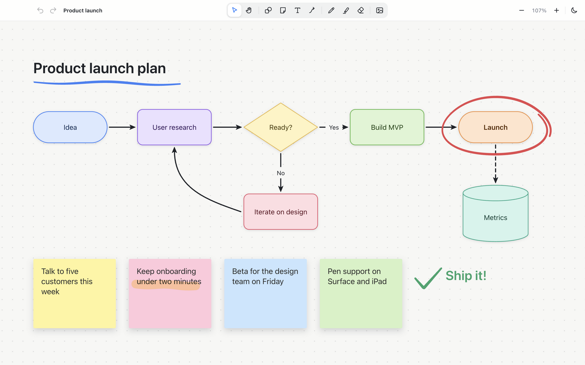
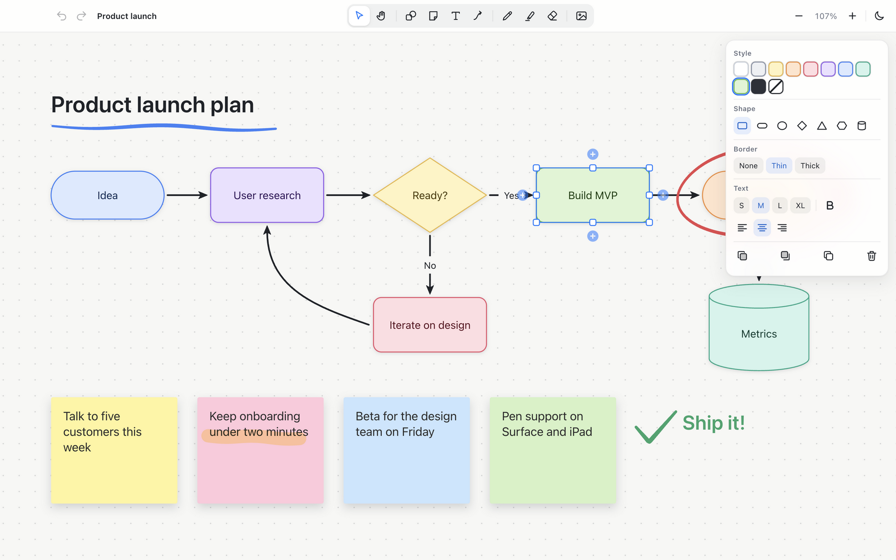
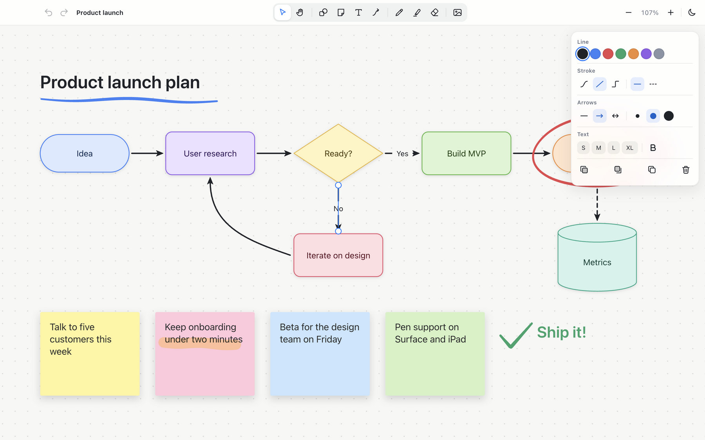
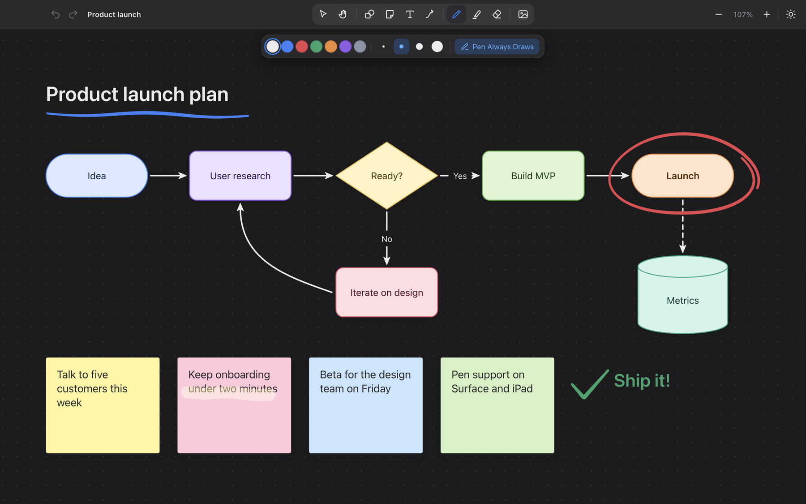

# Drawnie

An infinite whiteboard for simple, beautiful diagrams, inspired by macOS Freeform. Built with Electron and no frameworks: the canvas is plain SVG.

<picture>
  <source media="(prefers-color-scheme: dark)" srcset="docs/screenshots/board-dark.png">
  
</picture>

## Screenshots

<table>
  <tr>
    <td width="50%"></td>
    <td width="50%"></td>
  </tr>
  <tr>
    <td align="center"><b>Inspector</b>: styles, shapes, borders and text, with quick-connect handles around the selection.</td>
    <td align="center"><b>Connectors</b>: curved, straight or elbow lines that follow their shapes, with labels and arrows.</td>
  </tr>
  <tr>
    <td width="50%"></td>
    <td width="50%"></td>
  </tr>
  <tr>
    <td align="center"><b>Pen and highlighter</b>: pressure-sensitive ink, with palm rejection on pen devices.</td>
    <td align="center"><b>Dark mode</b>: follows the system, or toggle it from the top-right corner.</td>
  </tr>
</table>

## Features

- **Infinite canvas** with a dot grid, panning (wheel, trackpad, Space + drag, two fingers) and zoom (pinch, ⌘/Ctrl + wheel).
- **Shapes**: rectangle, pill, ellipse, diamond, triangle, hexagon and database, with 11 harmonious color styles and a soft shadow.
- **Sticky notes** and **free text** (double-click the canvas to type).
- **Connectors** that attach to shapes and follow them: curved, straight or elbow; with arrows, dashed lines and a text label.
- **Quick connect**: selecting a shape shows four "+" handles. Click one to create a connected twin shape, or drag it to connect to another shape.
- **Digital pen**: pressure-sensitive strokes, smoothing, highlighter and eraser (including the eraser end of pens such as Surface Pen or Wacom).
  - *Pen always draws* (on by default): with the Select tool active, the pen draws while the mouse or a finger selects.
  - Once a pen is detected, a finger selects and pans, and the palm is ignored while the pen touches the screen.
- Alignment guides while moving, multi-element resizing, layer order, and duplicate with ⌥/Alt + drag.
- Images: drag and drop, paste, or insert from the toolbar.
- Undo and redo, copy and paste between boards, export to **PNG** or **SVG**.
- `.drawnie` files (JSON) associated with the app, multiple windows, automatic light and dark mode.
- **English and Spanish**, with translations in `.po` files (gettext). The language can be changed from *View → Language* without restarting; the system language is used by default.

## Development

```bash
npm install
npm start
npm test          # translation system tests
```

> If `npm start` fails with `Cannot find module 'electron'` inside VS Code, the `ELECTRON_RUN_AS_NODE` variable is set in that environment. Run `env -u ELECTRON_RUN_AS_NODE npm start` or use a regular terminal.

## Packaging

```bash
npm run dist:mac   # .dmg and .zip for Apple Silicon (arm64) and Intel (x64)
npm run dist:win   # NSIS installer for x64 and arm64
npm run dist       # both
```

The packages are written to `dist/`:

```
Drawnie-<version>-mac-arm64.dmg / .zip   macOS Apple Silicon
Drawnie-<version>-mac-x64.dmg / .zip     macOS Intel
Drawnie-Setup-<version>.exe              Windows (x64 and arm64)
```

- **Icon**: generated from `build/icon.svg` with `npm run icon`, which writes `build/icon.png`. electron-builder derives the `.icns` and `.ico` from it.
- **macOS signing**: without a certificate the app is unsigned and Gatekeeper blocks it the first time (right-click → Open). To distribute it, set `CSC_LINK` / `CSC_KEY_PASSWORD` and configure notarization (`APPLE_ID`, `APPLE_APP_SPECIFIC_PASSWORD`, `APPLE_TEAM_ID`).
- **Windows from macOS**: the NSIS installer can be built on macOS. To sign it with Authenticode, build on Windows or in CI.

### Automated builds (GitHub Actions)

The [`.github/workflows/build.yml`](.github/workflows/build.yml) workflow:

- Runs the tests and checks that the translations are complete on every push to `main` and on every pull request.
- To **release a version**, bump the version in `package.json`, commit, and create the matching tag:

  ```bash
  npm version 0.2.0 -m "Release %s"   # updates package.json, commits and creates the v0.2.0 tag
  git push --follow-tags
  ```

  The workflow builds the installers on macOS and Windows and creates the GitHub *Release* with all of them attached. It stops if the tag does not match the version in `package.json`.
- **Manual build**: *Actions → Build → Run workflow* builds the installers without publishing anything; they can be downloaded as artifacts for 14 days.

The installers are currently unsigned. To sign them, add the certificates as repository *secrets* (`CSC_LINK`, `CSC_KEY_PASSWORD` and, for macOS, `APPLE_ID`, `APPLE_APP_SPECIFIC_PASSWORD`, `APPLE_TEAM_ID`), pass them as environment variables to the "Build installers" step and remove `CSC_IDENTITY_AUTO_DISCOVERY`.

## Translations

Strings follow the gettext model: they are written in English in the code, and each language has its own `.po` file in `locales/`. They can be edited with any text editor or with tools such as Poedit, Weblate or Crowdin.

```
locales/drawnie.pot   Template with every string (generated, do not edit)
locales/es.po         Spanish
locales/en.po         English (lets you adjust the wording without touching the code)
```

In the code:

```js
import { t, tc, tn, N_ } from './i18n.js';   // in main.js: const { t } = i18n

t('Save')                                // plain string
t('Could not save: {error}', { error })  // with placeholders
tc('verb', 'Open')                       // with context (msgctxt)
tn('{n} shape', '{n} shapes', count)     // plurals according to Plural-Forms
N_('Rectangle')                          // mark for extraction only; translate later with t()
```

In the HTML, use the `data-i18n` (text), `data-i18n-title` and `data-i18n-aria-label` attributes.

Workflow:

```bash
npm run i18n              # extracts the strings and updates drawnie.pot and every .po (like xgettext + msgmerge)
npm run i18n:check        # lists missing translations; exits with an error if any
npm run i18n -- --add fr  # creates locales/fr.po for a new language (like msginit)
```

- New strings appear in the `.po` files with `msgstr ""`. Until they are translated, the English original is shown.
- Entries flagged `#, fuzzy` are ignored until they are reviewed.
- Strings removed from the code are kept at the end as obsolete (`#~`). If they come back, their translation is restored.
- A new language shows up in the *Language* menu as soon as its `.po` file exists.
- The language preference is stored in `preferences.json`, inside the app's data folder.

## Shortcuts

| Key | Action | Key | Action |
|---|---|---|---|
| V | Select | P | Pen |
| H / Space | Pan canvas | M | Highlighter |
| R / O | Rectangle / Ellipse | E | Eraser |
| S | Sticky note | Enter | Edit text |
| T | Text | Delete / ⌫ | Delete |
| A | Connector | Arrows | Move (⇧ = 10 px) |
| ⌘/Ctrl + D | Duplicate | ⌘/Ctrl + 0 / 1 | 100 % / Fit |
| ⌘/Ctrl + ] / [ | Forward / Backward | ⌘/Ctrl + ⇧ + E | Export PNG |

Hold ⇧ to keep proportions and ⌘/Ctrl to disable the guides while moving.

## Project structure

```
main.js              Main process: windows, native menu, files, clipboard
preload.js           Secure bridge (contextIsolation + sandbox)
i18n.js              Active language, .po loading and saved preference
locales/             Translations (.pot and .po)
scripts/i18n.mjs     String extraction and translation updates
src/index.html       UI
src/styles.css       Styles (light/dark)
src/js/app.js        State, tools, gestures, history, inspector
src/js/render.js     Elements → SVG (screen and export)
src/js/geometry.js   Frames, anchors and connector routing
src/js/ink.js        Pressure-sensitive strokes
src/js/text.js       Text measuring and wrapping
src/js/palette.js    Colors and sizes
src/js/icons.js      Icons
src/js/i18n.js       Translations in the UI (t, tn, tc, data-i18n)
src/js/i18n-core.js  .po parsing, plurals and formatting (shared)
```

## License

Copyright (C) 2026 Jorge Juarez.

Drawnie is free software licensed under the [GNU AGPL-3.0](LICENSE) or later, with additional attribution terms described in [NOTICE](NOTICE):

- You may use, study, modify and redistribute it.
- Any modified or derived version must be released under the same license with its source code available, even when it is offered as a network service. It cannot be turned into closed-source software.
- The authorship notice of Jorge Juarez must be kept in the code, in the documentation and in the "About" screen.
- Modified versions must say so and must not be presented as the original Drawnie.
